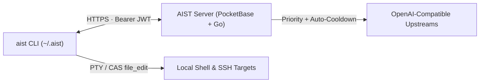

<div align="center">
  

  # AIST — AI Shell Assistant

  **On-call operations agent in your terminal — diagnose in natural language, confirm before executing, and govern keys, model routing & audit logs from one server.**

  [](go.mod)
  [](LICENSE)
  [](https://docs.aistrun.cc)

  English | [简体中文](README.zh-CN.md) · [Documentation](https://docs.aistrun.cc) · [Public Trial](https://aistrun.cc) · [Roadmap](https://github.com/llaoj/aist/labels/roadmap)
</div>

<p align="center">
  
</p>

## Why AIST

- **Zero-Config Thin Client** — Single ~10 MB static Go binary (`linux` amd64/arm64/arm/386/riscv64, `darwin` amd64/arm64) with zero runtime dependencies and zero upstream API keys on operator machines.
- **Human-in-the-Loop Guardrails** — Tiered command confirmation (`Query` vs double-confirmed `Modify`), shell AST denylist & full-screen TUI guards, and SHA-256 CAS `file_edit` diffs with automatic local backups.
- **Multi-Host SSH & Local Memory** — Executes on remote hosts via system `ssh` (reusing `~/.ssh/config`, `ProxyJump`, `ssh-agent`, and MFA) while keeping sessions and environment memory locally under `~/.aist/`.
- **Priority Routing & Auto-Cooldown** — Compatible with any OpenAI-compatible API (DeepSeek, OpenAI, Qwen, GLM, vLLM, Ollama); automatically cools down rate-limited or quota-exhausted models and fails over by priority.
- **Team Governance & Audit Trail** — Invite-code onboarding, per-user UTC weekly token quotas, daily usage metering, and searchable `shell_execute` / `file_edit` audit records in PocketBase `_logs`.
- **Single-Container & Air-Gapped Ready** — One ~42 MB Docker image embeds SQLite, the admin console (`/_/`), `/run.sh`, and all 7 platform client archives for offline intranet rollouts.

## Architecture

Every `aist` client connects to an AIST server (either the public trial at `https://aistrun.cc` or your own self-hosted instance). Clients handle terminal UX, local state, and command execution; the server owns authentication, key custody, model failover, quotas, and audit logging.



## Quick Start

### 1. Try the Public Server

Register an account with an invite code at [aistrun.cc/register](https://aistrun.cc/register), then install and sign in with one command:

```bash
curl -fL -# https://aistrun.cc/run.sh | sh
# Or with wget:
wget -qO- https://aistrun.cc/run.sh | sh
```

### 2. Self-Host in 5 Minutes (Docker Compose)

No external database, Redis, object storage, or required environment variables:

```yaml
# compose.yaml
services:
  server:
    image: ghcr.io/llaoj/aist-server:latest
    restart: unless-stopped
    ports:
      - "127.0.0.1:8090:8090"
    volumes:
      - ./data:/var/lib/aist
```

```bash
docker compose up -d
docker compose exec server su-exec aist server superuser upsert admin@example.com '<strong-password>'
```

Open `http://127.0.0.1:8090/_/` to set **Application URL**, add an OpenAI-compatible provider & model, and create a user (or invite code). Then install the matching client directly from your server:

```bash
curl -fL -# http://127.0.0.1:8090/run.sh | sh
```

### 3. Everyday CLI Usage

```bash
aist                                                 # Interactive troubleshooting session
aist "Why is nginx returning 502 on web1?"           # One-shot diagnosis (local or SSH target)
journalctl -u nginx -n 200 | aist "Find root cause"  # Read-only pipe log analysis
aist sessions                                        # Browse and resume local sessions
aist lang zh                                         # Switch CLI language locally (zh | en)
```

## Documentation

Full bilingual documentation is hosted at **[docs.aistrun.cc](https://docs.aistrun.cc)** (source under [`docs/`](docs/)):

- [Overview & Core Architecture](https://docs.aistrun.cc/getting-started/overview) · [5-Minute Self-Hosting](https://docs.aistrun.cc/getting-started/self-hosting)
- [Interactive, One-Shot & Pipe Modes](https://docs.aistrun.cc/user-guide/modes) · [Multi-Host SSH](https://docs.aistrun.cc/user-guide/ssh-targets) · [Confirmation & Guardrails](https://docs.aistrun.cc/user-guide/safety-and-confirmation)
- [Docker Compose Production Deployment](https://docs.aistrun.cc/deployment/docker-compose) · [Air-Gapped & Local LLM (vLLM / Ollama)](https://docs.aistrun.cc/deployment/air-gapped-and-local-llm)
- [Providers, Priority & Cooldown](https://docs.aistrun.cc/administration/providers-and-models) · [Users, Invites & Quotas](https://docs.aistrun.cc/administration/users-invites-quotas) · [Audit Logs](https://docs.aistrun.cc/administration/audit-logs)
- [Security Overview](https://docs.aistrun.cc/security/overview) · [CLI & State Directory](https://docs.aistrun.cc/reference/cli-and-state) · [HTTP API & Errors](https://docs.aistrun.cc/reference/api-and-errors)

## Community & Security

- **Contributing** — Issues and pull requests are welcome in English or Chinese. Please read [CONTRIBUTING.md](CONTRIBUTING.md) and our [Contributor License Agreement](CLA.md) first.
- **Roadmap** — Planned features (streaming responses, OIDC/LDAP SSO, webhook alerts, optional full-conversation audit) are tracked under [Roadmap Issues](https://github.com/llaoj/aist/labels/roadmap).
- **Security** — Do not report vulnerabilities in public issues. Follow [SECURITY.md](SECURITY.md) or email [security@aistrun.cc](mailto:security@aistrun.cc).

## License

Copyright (c) 2026 llaoj and aist contributors.

Both the client and server are licensed under the [GNU Affero General Public License v3.0](LICENSE) (**AGPL-3.0**):

- **Free Use** — Individuals and organizations may deploy and run unmodified AIST internally without fees or source-disclosure obligations.
- **AGPL Obligations** — If you modify AIST and distribute it or offer it as a network service to others, you must make the complete corresponding source code available under AGPL-3.0.
- **Commercial Licensing** — Organizations that wish to embed or offer modified AIST without AGPL-3.0 obligations can purchase a commercial license: [contact@aistrun.cc](mailto:contact@aistrun.cc).
