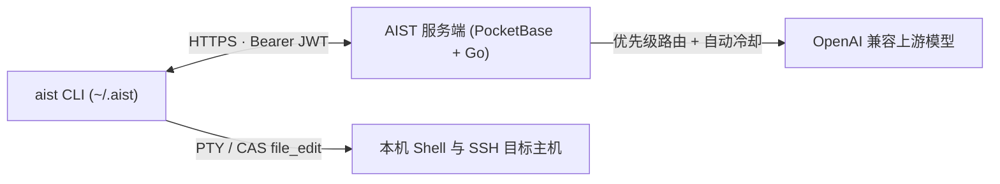

<div align="center">
  

  # AIST — AI Shell Assistant

  **常驻终端的 On-Call 运维智能体 —— 自然语言诊断、确认后执行，由服务端统一托管密钥、模型路由与操作审计。**

  [](go.mod)
  [](LICENSE)
  [](https://docs.aistrun.cc/zh/)

  [English](README.md) | 简体中文 · [文档站](https://docs.aistrun.cc/zh/) · [在线体验](https://aistrun.cc) · [Roadmap](https://github.com/llaoj/aist/labels/roadmap)
</div>

<p align="center">
  
</p>

## 核心亮点

- **零配置极薄客户端** — 约 10 MB 单文件 Go 静态二进制（支持 `linux` amd64/arm64/arm/386/riscv64 与 `darwin` amd64/arm64），无运行时依赖，终端机器不落盘任何上游 API Key 或模型配置。
- **人机协同安全护栏** — 查询命令与修改命令分级确认（修改命令二次确认），基于 Shell AST 拦截黑名单与全屏交互程序，`file_edit` 展示彩色 Diff、校验 SHA-256 防并发覆盖并自动本地备份。
- **多主机 SSH 与环境记忆** — 直接调用系统 `ssh`（无缝复用 `~/.ssh/config`、`ProxyJump`、`ssh-agent` 与 MFA），会话历史与集群环境记忆仅保存在本机 `~/.aist/`。
- **优先级路由与自动冷却** — 兼容任意 OpenAI 接口（DeepSeek、通义千问、智谱 GLM、OpenAI、vLLM、Ollama），遇到限流或额度耗尽自动进入冷却并按优先级回退至下一可用模型。
- **团队管控与操作审计** — 支持邀请码自助注册、按 UTC 自然周限制用户 Token 额度、按日计量用量，并在 PocketBase `_logs` 中完整记录 `shell_execute` / `file_edit` 审计轨迹。
- **单容器零依赖与纯内网就绪** — 约 42 MB 服务端镜像同时内置 SQLite、管理后台（`/_/`）、`/run.sh` 启动脚本与全部 7 个平台的客户端安装包，断网内网也可一键分发。

## 核心架构

所有 `aist` 客户端统一连接 AIST 服务端（可使用官方体验服务 `https://aistrun.cc`，也可私有化自建）。客户端专注终端交互、本机状态与命令执行；认证、密钥托管、模型容灾、配额与审计全部收敛在服务端。



## 快速开始

### 1. 直接体验官方服务

前往 [aistrun.cc/register](https://aistrun.cc/register) 使用邀请码创建账号，随后在终端一行命令完成安装并登录：

```bash
curl -fL -# https://aistrun.cc/run.sh | sh
# 无 curl 环境可使用 wget：
wget -qO- https://aistrun.cc/run.sh | sh
```

### 2. 5 分钟私有化部署（Docker Compose）

无需外部数据库、Redis、对象存储或必填环境变量：

```yaml
# compose.yaml
services:
  server:
    image: ghcr.io/llaoj/aist-server:latest
    restart: unless-stopped
    ports:
      - "127.0.0.1:8090:8090"
    volumes:
      - ./data:/var/lib/aist
```

```bash
docker compose up -d
docker compose exec server su-exec aist server superuser upsert admin@example.com '<strong-password>'
```

浏览器打开 `http://127.0.0.1:8090/_/` 设置 **Application URL**、添加上游 Provider 与模型并创建用户（或邀请码），即可直接从你的服务端安装同版本客户端：

```bash
curl -fL -# http://127.0.0.1:8090/run.sh | sh
```

### 3. 常用命令

```bash
aist                                                 # 进入多轮交互式排障
aist "web1 上 nginx 为什么报 502？"                  # 单次诊断（支持本机或 SSH 目标）
journalctl -u nginx -n 200 | aist "定位报错根因"     # 只读管道日志分析
aist sessions                                        # 查看并恢复本机历史会话
aist lang zh                                         # 切换客户端本地显示语言 (zh | en)
```

## 文档导航

完整中英双语文档站：**[docs.aistrun.cc/zh](https://docs.aistrun.cc/zh/)**（源码位于 [`docs/zh/`](docs/zh/)）：

- [产品定位与核心架构](https://docs.aistrun.cc/zh/getting-started/overview) · [5 分钟私有化部署](https://docs.aistrun.cc/zh/getting-started/self-hosting)
- [交互、单次与管道模式](https://docs.aistrun.cc/zh/user-guide/modes) · [多主机 SSH 排障](https://docs.aistrun.cc/zh/user-guide/ssh-targets) · [命令确认与安全护栏](https://docs.aistrun.cc/zh/user-guide/safety-and-confirmation)
- [Docker Compose 生产部署](https://docs.aistrun.cc/zh/deployment/docker-compose) · [纯内网离线部署与本地模型接入](https://docs.aistrun.cc/zh/deployment/air-gapped-and-local-llm)
- [模型路由与自动冷却](https://docs.aistrun.cc/zh/administration/providers-and-models) · [用户、邀请码与周限额](https://docs.aistrun.cc/zh/administration/users-invites-quotas) · [工具调用与请求审计](https://docs.aistrun.cc/zh/administration/audit-logs)
- [安全架构总览](https://docs.aistrun.cc/zh/security/overview) · [CLI 命令与状态目录](https://docs.aistrun.cc/zh/reference/cli-and-state) · [HTTP 接口与错误码](https://docs.aistrun.cc/zh/reference/api-and-errors)

## 社区与安全

- **参与贡献** — 欢迎提交中文或英文 Issue 与 PR。提交代码前请阅读 [CONTRIBUTING.md](CONTRIBUTING.md) 与 [贡献者许可协议（CLA）](CLA.md)。
- **演进路线** — 规划特性（流式响应、OIDC/LDAP 单点登录、Webhook 告警、可选完整对话合规审计）统一在 [Roadmap Issues](https://github.com/llaoj/aist/labels/roadmap) 跟踪。
- **安全漏洞上报** — 请勿在公开 Issue 中披露安全问题，请按 [SECURITY.md](SECURITY.md) 私密上报或发邮件至 [security@aistrun.cc](mailto:security@aistrun.cc)。

## 许可证与商业授权

Copyright (c) 2026 llaoj and aist contributors.

aist 客户端与服务端全部基于 [GNU Affero General Public License v3.0](LICENSE)（**AGPL-3.0**）开源：

- **免费使用** — 个人或企业在内部部署、使用未经修改的 aist，无需付费，也不产生开源义务。
- **AGPL 义务** — 若修改了 aist 并将修改版本分发给他人，或通过网络向他人提供服务（如对外托管运营），则必须以 AGPL-3.0 公开完整对应源代码。
- **商业授权** — 不希望履行 AGPL-3.0 传染性义务（如闭源二次开发集成或商业化对外托管）的企业可购买商业授权，请联系 [contact@aistrun.cc](mailto:contact@aistrun.cc)。
