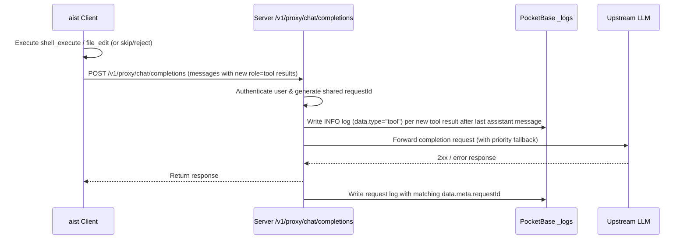

# Tool & Traffic Audit Logs

AIST records structured audit logs for every `shell_execute` and `file_edit` invocation directly into PocketBase's built-in `_logs` database (`auxiliary.db`), viewable and searchable in `/_/` → **Logs** with zero extra infrastructure.


## How Zero-Overhead Collection Works



- **Stateless delta extraction**: Only `role=tool` messages appearing **after the last `assistant` message** in `messages` are recorded, preventing historical turns from being logged repeatedly.
- **Covers blocked and rejected calls**: Commands blocked by the blacklist/TUI guard (`Status: skipped`) or rejected by the user (`Status: rejected`) are also sent back as `role=tool` messages and recorded in the audit trail.
- **Correlated with HTTP traffic logs**: Every proxy call generates a `requestId` written to both `data.requestId` (on tool audit logs) and `data.meta.requestId` (on PocketBase's HTTP request log).

## Audit Log Fields (`data`)

Log list summary (`message`):
- `shell_execute @web1: systemctl restart nginx`
- `file_edit @local: /etc/nginx/nginx.conf`

Structured `data` attributes:

| Key | Description | `shell_execute` | `file_edit` |
|---|---|---|---|
| `type` | Fixed `"tool"` (distinguishes from `"request"` logs) | ✓ | ✓ |
| `tool` | `"shell_execute"` or `"file_edit"` | ✓ | ✓ |
| `authId` | User record ID (always recorded regardless of `LogAuthId`) | ✓ | ✓ |
| `email` | User email address | ✓ | ✓ |
| `userIP` | Client IP (omitted when `Settings → Logs → LogIP` is disabled) | ✓ | ✓ |
| `requestId` | Correlation ID matching HTTP request log `data.meta.requestId` | ✓ | ✓ |
| `target` | Target host (`"local"` or SSH target) | ✓ | ✓ |
| `reason` | Model's stated reason for the action | ✓ | ✓ |
| `command` | Raw shell command (up to 4,000 UTF-8 bytes) | ✓ | |
| `commandType` | `"query"` / `"modify"` / `"unknown"` | ✓ | |
| `path` / `sudo` | Target file path and `sudo` boolean | | ✓ |
| `old` / `new` | `old_content` and `new_content` (up to 4,000 bytes each) | | ✓ |
| `result` | Structured result header (`Status`, `Exit Code`, `Error`, `Detail`) + output (up to 6,000 bytes; total serialized `data` capped safely below 14 KB so identity keys are never dropped) | ✓ | ✓ |

## Ready-to-Use Filter Expressions in `/_/` → Logs

Paste any of the following into the PocketBase **Logs** search bar:

```text
# All tool executions
data.type = "tool"

# Actions by a specific user
data.type = "tool" && data.email = "alice@example.com"

# State-modifying shell commands across all hosts
data.tool = "shell_execute" && data.commandType = "modify"

# Commands or file edits on a specific SSH host
data.type = "tool" && data.target = "web1"

# Sudo file edits
data.tool = "file_edit" && data.sudo = true

# Failed commands
data.type = "tool" && data.result ~ "Status: failed"

# Correlate a tool execution with its HTTP proxy request
data.requestId = "<requestId>" || data.meta.requestId = "<requestId>"
```

## Retention & Trust Boundary

- **Retention (`MaxDays`)**: Controlled in `/_/` → **Settings → Logs → Max days** (PocketBase default: `5` days; increase to `30` or `90` days for longer operational retention). Keep `MaxDataSize` at `16 KB` or above.
- **Trust boundary**: Audit payloads are extracted from client-reported conversation messages. If a user terminates `aist` immediately after running a command without sending a follow-up request, or runs a modified client binary, that local execution cannot be observed by the server. Pair AIST audit logs with host-level SSH / `auditd` logs in high-compliance environments.
