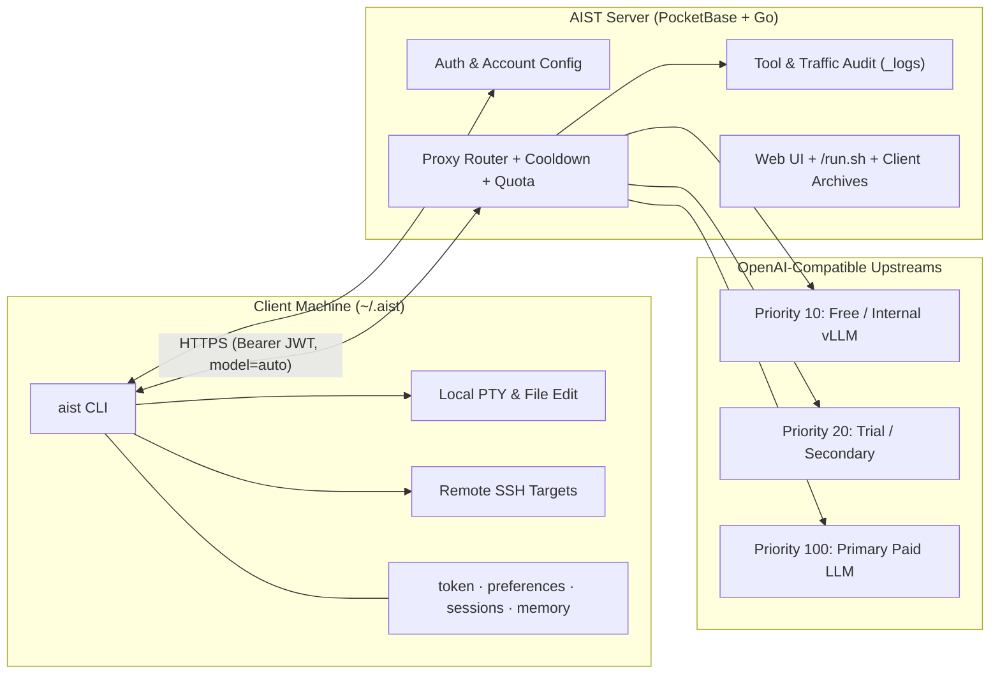

# Overview & Core Architecture

**AIST (AI Shell Assistant)** is an on-call command-line operations agent built for SREs, DevOps engineers, and backend developers. Describe an incident or task in plain language — AIST inspects live system state, proposes commands or file edits, waits for your confirmation, runs them in a real terminal PTY (locally or over SSH), and feeds the output back into the loop until the issue is resolved.

## Architectural Principle: All Clients Go Through an AIST Server

Unlike standalone CLI wrappers that scatter provider API keys across laptops and jump hosts, **every `aist` client connects to an AIST server** (either the public trial service at `https://aistrun.cc` or your own self-hosted instance).

### Clear Division of Responsibilities

| Layer | Owns | Never Touches |
|---|---|---|
| **Client (`aist`)** | Interactive UI, local language preference (`~/.aist/preferences.json`), session persistence & compaction, local environment Memory (`~/.aist/memory/`), AST command guardrails, local/SSH PTY execution, and CAS file editing with backups | Upstream provider URLs, model lists, real API keys, or routing policy |
| **Server (`server`)** | PocketBase authentication (password / email verification / OTP / MFA), invite-code registration, API key custody, priority-based model routing & automatic cooldown, weekly UTC token quotas, daily usage metering, tool audit logging, and version-matched client distribution | Your SSH credentials, sudo passwords, or local Memory files |

## Key Capabilities at a Glance

- **Three CLI workflows**:
  - `aist`: multi-turn interactive troubleshooting session;
  - `aist "why is port 443 refusing connections?"`: one-shot investigation from the shell;
  - `journalctl -u nginx -n 200 | aist "find the root cause"`: read-only pipe analysis.
- **Human-in-the-loop safety**:
  - Every `shell_execute` step displays its `reason`, target host, and command classification (`Query command` vs `Modify command`, with an extra warning prompt for state-changing commands).
  - Account-defined command blacklists and full-screen TUI guards (`vim`, `less`, `htop`, interactive `top`, `tmux`, etc.) are enforced via shell AST parsing before confirmation.
  - `file_edit` renders a colorized diff before writing, verifies target file SHA-256 to prevent concurrent clobbering, and stores up to 10 historical backups per file under `~/.aist/fileedit/backups/`.
- **Single-container deployment**:
  - One ~42 MB Docker image embeds SQLite (PocketBase), the admin console (`/_/`), public landing & registration pages (`/` and `/register`), `/run.sh` bootstrapper, and all 7 OS/Arch client tarballs.

## Next Steps

- Want to try AIST right away without deploying anything? Continue to [Quickstart (Public Trial)](./quickstart.md).
- Ready to run your own private instance? Jump to [5-Minute Self-Hosting](./self-hosting.md).
