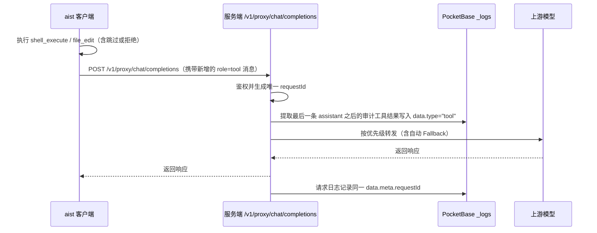

# 工具调用与请求审计日志

AIST 将用户通过终端执行的 `shell_execute` 与 `file_edit` 操作自动写入 PocketBase 原生日志库（`_logs` / `auxiliary.db`），直接在 `/_/` → **Logs** 页面即可检索、筛选与排查，无需额外部署日志组件。


## 零客户端上报的无状态采集机制



- **增量精准提取**：每次请求只提取 `messages` 中**最后一条 `assistant` 消息之后**新增的 `role=tool` 消息，历史轮次不会重复入库；即便该次请求后续没有可用模型返回 `403`，已完成的操作依然会被忠实记录。
- **未执行动作同样留痕**：被黑名单拦截、被全屏 TUI 规则拦截（`Status: skipped`）或被用户在确认菜单拒绝（`Status: rejected`）的工具调用也会完整记录。
- **与 HTTP 流量日志双向关联**：每次代理请求生成的 `requestId` 同时写入工具日志的 `data.requestId` 与 HTTP 请求日志的 `data.meta.requestId`。

## 审计日志结构

列表页标题（`message`）直观显示目标主机与操作摘要：
- `shell_execute @web1: systemctl restart nginx`
- `file_edit @local: /etc/nginx/nginx.conf`

详情页 `data` 字段说明：

| 字段 | 说明 | `shell_execute` | `file_edit` |
|---|---|---|---|
| `type` | 固定为 `"tool"`（与 `"request"` 请求日志区分） | ✓ | ✓ |
| `tool` | `"shell_execute"` 或 `"file_edit"` | ✓ | ✓ |
| `authId` | 用户记录 ID（始终记录，不受 `LogAuthId` 开关影响） | ✓ | ✓ |
| `email` | 用户登录邮箱 | ✓ | ✓ |
| `userIP` | 客户端来源 IP（跟随后台 `LogIP` 开关） | ✓ | ✓ |
| `requestId` | 关联同一次代理 HTTP 请求日志的 `data.meta.requestId` | ✓ | ✓ |
| `target` | 执行目标主机（本机为 `"local"`，远端为 SSH 主机标识） | ✓ | ✓ |
| `reason` | 模型给出的操作原因 | ✓ | ✓ |
| `command` | 完整 Shell 命令（上限 4000 字节） | ✓ | |
| `commandType` | `"query"` / `"modify"` / `"unknown"` | ✓ | |
| `path` / `sudo` | 目标文件路径与是否使用 `sudo` 提权 | | ✓ |
| `old` / `new` | 修改前后的文本片段（各上限 4000 字节） | | ✓ |
| `result` | 结构化状态头（`Status`、`Exit Code`、`Error`、`Detail`）+ 命令输出（单字段上限 6000 字节，整条 JSON 自动控制在 14 KB 以内，确保身份与元数据字段绝不因超长被丢弃） | ✓ | ✓ |

后台已内置多行样式优化，点开日志详情即可按原始换行阅读 `result`、`old` 与 `new` Diff 内容。

## 后台 Logs 常用筛选表达式

直接复制以下表达式粘贴到 `/_/` → **Logs** 顶部搜索框即可过滤：

```text
# 查看全部工具操作审计
data.type = "tool"

# 按指定用户邮箱排查操作
data.type = "tool" && data.email = "alice@example.com"

# 筛选所有状态变更类（modify）命令
data.tool = "shell_execute" && data.commandType = "modify"

# 查看在某台远端主机 web1 上的所有操作
data.type = "tool" && data.target = "web1"

# 筛选使用 sudo 提权的文件修改
data.tool = "file_edit" && data.sudo = true

# 筛选执行失败的命令
data.type = "tool" && data.result ~ "Status: failed"

# 联动查询同一次代理请求的工具日志与 HTTP 流量日志
data.requestId = "<requestId>" || data.meta.requestId = "<requestId>"
```

## 留存周期与可信边界

- **日志保留天数（`MaxDays`）**：在 `/_/` → **Settings → Logs** 中调整 `Max days`（PocketBase 默认保留 `5` 天，生产环境可按需调至 `30` 或 `90` 天）。请保持 `MaxDataSize` 不低于默认的 `16 KB`。
- **可信边界说明**：工具结果由客户端在后续模型请求的消息历史中携带。若用户执行完命令后直接强杀进程且不再继续该会话，或自行篡改客户端二进制，服务端将无法观测该次本地执行。强合规生产环境建议同时结合堡垒机或主机侧 `auditd` 审计。
