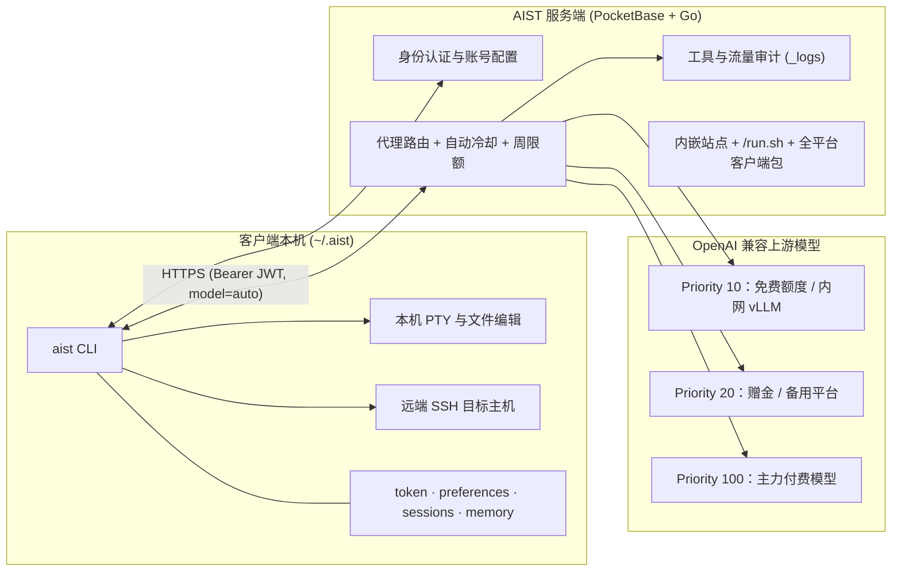

# 产品定位与核心架构

**AIST（AI Shell Assistant）** 是面向运维工程师、SRE 与后端开发者的命令行 On-Call 智能体。你只需用自然语言描述故障或运维目标，AIST 就会给出排查思路、建议要执行的命令或文件变更，在**征得你明确确认后**通过真实终端 PTY 在本机或远端 SSH 主机执行，并将执行输出继续送入下一轮分析，形成完整的排障闭环。

## 核心架构原则：所有客户端统一经过 AIST 服务端

不同于需要在每台跳板机、开发机上到处配置 API Key 的单机脚本，**所有 `aist` 客户端都统一连接 `aist` 服务端**（可以直接使用官方体验服务 `https://aistrun.cc`，也可以用单容器镜像在团队内网私有化部署）。

### 客户端与服务端职责边界

| 层级 | 负责的内容 | 绝不触碰的内容 |
|---|---|---|
| **客户端 (`aist`)** | 终端交互界面、本地语言偏好（`~/.aist/preferences.json`）、会话持久化与上下文压缩、本机环境记忆（`~/.aist/memory/`）、基于 Shell AST 的黑名单与全屏程序拦截、本机/SSH PTY 命令执行、带 CAS 校验与本地备份的文件编辑 | 上游 Provider 地址、模型列表、真实 API Key、路由策略 |
| **服务端 (`server`)** | PocketBase 认证（密码 / 邮箱验证 / OTP / MFA）、邀请码自助注册、上游 API Key 托管、模型优先级路由与自动冷却恢复、每周 Token 限额、按日用量统计、工具审计日志采集、同版本客户端分发 | 你的 SSH 私钥、终端输入的 `sudo`/MFA 密码、本机 Memory 文件 |

## 核心能力一览

- **三种高频命令行使用方式**：
  - `aist`：进入多轮交互式排障会话；
  - `aist "为什么 443 端口连接被拒绝？"`：单次提问并完成排障后退出；
  - `journalctl -u nginx -n 200 | aist "定位报错根因"`：只读管道日志分析。
- **人机协同安全护栏**：
  - 每步 `shell_execute` 均清晰展示执行原因、目标主机以及「查询命令 / 修改命令」分类（修改命令会弹出二次风险确认）。
  - 执行前通过 Shell AST 解析拦截账号黑名单命令（含管道、子 Shell、`sudo`、`sh -c` 等包装）以及 `vim`、`less`、`htop` 等全屏交互程序。
  - `file_edit` 写入前展示彩色 Diff，基于原文件 SHA-256 做并发防覆盖校验，并在 `~/.aist/fileedit/backups/` 自动保留最近 10 个历史版本。
- **单容器零依赖部署**：
  - 约 42 MB 的服务端镜像同时内置 SQLite（PocketBase）、管理后台（`/_/`）、落地页与注册页（`/` 与 `/register`）、`/run.sh` 启动脚本以及 7 个主流平台的客户端安装包。

## 下一步

- 想零部署直接上手体验？请阅读 [快速体验（官方服务）](./quickstart.md)。
- 想在团队或内网搭建自有服务端？请阅读 [5 分钟私有化部署](./self-hosting.md)。
